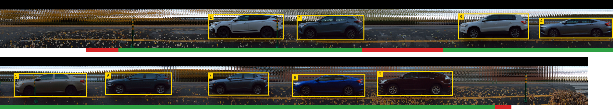

# curb-occupancy

On-street parking occupancy from bike-mounted camera footage. Each pass along a street becomes
a pushbroom mosaic of the parked row; vehicles are detected on the mosaic and filtered by
metric geometry; passes are placed on the street's OpenStreetMap centreline; curb regulations
(city open data, hand-drawn driveways) give the capacity of each block, and occupancy follows
an occupancy-study guideline (here the City of Montreal's).

**Scope.** Built and validated for one study: rue de Terrebonne and the side streets around it
(Notre-Dame-de-Grâce, Montreal), October-November 2026, one camera (GoPro HERO8 Black).
Everything specific to that street, city and camera sits in config (the study repository,
[ndg-terrebonne-parking-2026][study], `config/`), a city adapter (`adapters/montreal.py`)
and a rig profile (`rigs/gopro_hero8_wide_hseis/`); the rest is generic in intent but untested
on any other street, city or camera.

[study]: https://github.com/laurentpt/ndg-terrebonne-parking-2026



*One block of one pass (`tools/example_block.py`): the curb image at the depth of the parked
row (background smeared), the vehicles counted, and the curb status at the time of the pass
(green: parkable, red: no stopping).*

## Layout

```
src/curb_occupancy/
  capture/      video decoding, GoPro telemetry (GPMF), camera motion, lens model
  mosaic.py     pushbroom mosaics at the parked-row planes
  detect.py     vehicle detector on mosaic tiles + metric acceptance tests
  street.py, osm.py, axismap.py, layout.py, blocks.py
                street model (cross-section, OSM axis), pass alignment, street layout
  count.py, multiday.py
                parked vehicles per pass; all passes on the street axis, per block
  regs/         regulation schema, sources (manual, osm), supply (curb status, capacity,
                occupancy), guideline profiles
  adapters/     city data sources (montreal.py: signage + hydrants open data)
  rigs/         camera rig profiles (lens profile, rolling shutter, IMU axes)
  publish/      maps (review / public), area merge, ride views, curb labeller
  capacity.py   area capacity: measured block faces + estimated ones from OSM lengths
  ride.py       one long recording -> one clip per street pass
  cli.py        `curb-occupancy` command
tests/
tools/          figures (`example_block.py`, `distribution_figure.py`), lock-file refresh (`lock.py`)
```

## Setup

```bash
make env          # conda env `curb-occupancy` (Python 3.11, ffmpeg with NVDEC) + pinned pip deps
make test
```

Install with `make env`: the package itself declares no dependencies (they are pinned in
`requirements.lock.txt`), so a bare `pip install` of this repository gives a non-working
install. Without conda: `pip install -r requirements.lock.txt`, then
`pip install --no-deps -e .`, with ffmpeg on the PATH.

The pipeline expects an NVIDIA GPU (default `device: cuda`; ffmpeg decodes with NVDEC). The
pinned torch is 2.7.1+cu118, which needs a driver supporting CUDA 11.8 (directly or through
CUDA 11 minor-version compatibility). For another CUDA version, change the torch lines in
`requirements.in` and run `make lock`.

The detector (D-FINE-X, `ustc-community/dfine-xlarge-obj2coco`, Apache-2.0) is downloaded
from the Hugging Face hub on first use. Video goes in `workdir/input_data/`; every output in
`workdir/runs/<config name>/`, relative to the working directory. Commands run from the root
of the study repository (paths in the configs are relative to it).

## Run

From the study repository ([ndg-terrebonne-parking-2026][study]):

```bash
S=config/streets
curb-occupancy telemetry $S/terrebonne_evening.yaml           # GPS of the reference pass
curb-occupancy fetch $S/terrebonne_evening.yaml               # OSM extract + city open data (missing files)
curb-occupancy run $S/terrebonne_evening.yaml                 # all stages, cached per clip
curb-occupancy mosaic $S/terrebonne_evening.yaml --clip GX014484 --force
curb-occupancy area $S/_area_final.yaml                       # several streets -> one table set + public map
curb-occupancy serve $S/terrebonne_evening.yaml               # map pages on http://127.0.0.1:8000
curb-occupancy segment config/rides/2026-10-29_GX014499.yaml  # long recording -> street clips
```

Per-street YAML (defaults in `config.py`; `extends: <file>` merges a shared base):

- `clips`: one entry per pass (`file`: one file or the chapter files of one recording;
  `t_range`; `direction` label or `auto`; optional `camera` overrides such as `height_m`
  when the mount changed). Geometry settings are metric and converted to each clip's
  camera-height units. With `camera.scale: gps` (default) a clip with a good GPS fix uses the
  height implied by GPS speed / visual speed (`scale_check.json`); other clips use the
  nominal `height_m`. A new evening = append its clip and re-run.
- `camera`: `rig` (a profile in `rigs/`), `height_m`, `view_side` (`left` or `right` of
  travel; a right view is rendered mirrored, so every later stage sees the same geometry),
  `speed: gps` (motion from the GPS Doppler speed, for dusk passes).
- `street`: `name` (OSM), `osm_json` (extract), and the cross-section (required): `rows`
  (parking lanes: the curb whose signs govern each, right/left of the street-axis direction,
  and the mosaic plane imaging it when riding forward/backward) and `states` (sets of rows
  that can be present at a point; `[[A], [B]]` = one lane switching sides, `[[A, B]]` = both
  sides always); `mosaic.planes`: the depth band of each plane.
- `regulations.sources`: `montreal` (signage + hydrants open data), `osm` (alleys / lot
  entrances), `manual` (zones and points written in the config or drawn in the curb
  labeller: driveways, site corrections, any city; see `regs/manual.py`).
- `guideline.profile` (required with regulations): occupancy method (`montreal`: 5.5 m per
  space, 17-21 h, three evenings, >= 85 % optimal, < 80 % low; fields overridable).
- `detect`: `backend` `hf` (a `transformers` COCO detector, default D-FINE-X) or `yolo`
  (Ultralytics, not installed: `pip install ultralytics`, AGPL-3.0), `model`, `min_conf`.

Outputs in `workdir/runs/<config name>/`:

| per clip | |
|---|---|
| `telemetry.json/.npz`, `video.json` | GPMF settings, GPS fix quality, shutter/ISO, IMU (camera frame) |
| `heading.npz`, `orientation.csv` | visual travel direction; fused roll/pitch/yaw per frame |
| `profiles.npz`, `trace.csv` | per-row flow profiles; speed, along-street position, horizon depth |
| `scale_check.json` | GPS vs visual speed: implied camera height, path lengths |
| `mosaic_<plane>.png/.json` | pushbroom mosaics at the parked-row planes |
| `raw_<plane>.csv/.json` | cached detector boxes and the detector that made them |
| `det_<plane>.csv` | all detections with geometry, reject reason, flow ratio / flags |
| `overlay_<plane>/` | review JPEGs; dimmed = not the parked row here, magenta = travel lane / other side |
| `cars.csv`, `count.json`, `occupancy_25m.csv` | parked vehicles (layout-gated) and totals |
| `counts_by_block.csv`, `review.csv` | per-block counts; travel-lane / stopped / flagged items to check |

| per run | |
|---|---|
| `layout/` | street axis (`axis.json`, mapped `osm_crossings.csv`), clip axis maps, rows present per segment, named intersections, blocks, `layout.png` |
| `multiday/` | all passes on the street axis, per row: `curb.csv` (per-metre occupancy per pass), `supply.csv`, `counts_by_block.csv` (block x row x pass), `occupancy.png` |
| `supply/` | regulations on the street axis (`zones.csv`, `points.csv`, source tables), per-metre `curb_status.csv` per row and pass, `capacity_by_pass.csv`, `occupancy_by_pass.csv`, `stretches.csv`, `occupancy_{evening,all_passes}.csv`, `supply.json` |
| `map/` | `public.html` + `layers.geojson` (occupancy, parkable curb, anonymous car footprints); private: `review.html`, `curb.html` (labeller), `ride_<clip>.jpg` |

An area (`curb-occupancy area`) writes `workdir/runs/<area name>/`: `summary.json`, `report.md`,
`stretches.csv`, `blocks_by_pass.csv`, `capacity_faces.csv`, `layers.geojson`, `public.html`.

## Method

Counting needs no GPS (regulations and the mapped axis do). The accelerometer gives gravity,
two-view geometry (KLT + essential matrix) gives the travel direction; together they define a
street-aligned frame, so every frame is reprojected (Gyroflow fisheye profile, GPU) into a
level virtual pinhole looking perpendicular to travel — mount roll/yaw drift disappears.
Per-row flow in that view is linear in the row for the road (slope = v·dt/h), giving metric
speed from the camera height h, and a plateau for the parked row (depth = f·slope/flow). The
mosaic samples the vertical plane at the parked depth orthographically (with rolling-shutter
compensation), so parked cars have true length and height; a detection's ground contact then
yields its lateral distance, which rejects nearer (bollards, cyclists) and farther
(cross-street, other side) objects.

**Detector.** D-FINE-X (COCO classes car, motorcycle, bus, truck) on 1280 px mosaic tiles,
each letterboxed into the model's 640 x 640 input. On the study's 1258 vehicles accepted by
the earlier detector (YOLO11-L) it agrees on 1253; of the disagreements that fall where a row
is counted, each detector is right on some (an occluded car, a car at dusk, a truck split in
two, a moving car).

**Street layout.** The cross-section's parking rows are each imaged by one mosaic plane per
riding direction, and the set of rows present changes rarely along the street. All clips are
mapped onto the reference pass's axis (occupancy alignment, reversed for the opposite
direction), static kept detections vote for the row their plane images, and a Viterbi over
the allowed row sets with a large switch cost segments the street (switches snapped to a
cross street). Counting then keeps only detections of planes imaging a present row: where a
row is absent its plane sees the travel lane, so this one rule removes traffic (stopped or
queued buses) and near cars re-detected in the far mosaic. Plane depths are re-estimated from
each clip's active segments and mosaics rebuilt when they move. `curb-occupancy run` does detect ->
layout -> (rebuild moved planes) -> layout -> count.

**Street axis.** With GPS on the reference pass and an OpenStreetMap extract, run-level
outputs live on the mapped centreline in map metres: the reference pass's visual axis is
fitted to its (lag-corrected) GPS track projected on the centreline (affine + 100 m knots).
Cross streets come from the map, with their names and the side they join from; the cameras
supply their extent. Without the map the axis is the reference GPS track; without GPS, the
reference pass's visual axis.

**Supply.** Regulation sources produce zones in one schema (`regs/rules.py`: kind, time rule,
row, extent); `regs/supply.py` resolves them per curb metre and row at each pass's date and
time, adds legal clearances (intersections only for the rows whose curb they cut, hydrants),
and counts capacity per block and row with the guideline profile. Observations check the
regulations: a no-stopping zone with cars parked in it on several passes is reported as
disputed.

**Area capacity.** `capacity.py` splits the OSM centrelines of the listed streets into block
faces at every named crossing; a face a run covered keeps its measured capacity, the others
get the sampled faces' spaces per metre times their OSM length (minus listed signed
restrictions), with a ratio-model interval on the area total.

## Another street, city or camera

1. Street config: `street.name`, `osm_json`, the cross-section (`rows`, `states`, and
   `mosaic.planes` depth bands covering each row's distance from the riding line),
   `camera.view_side`. See the study repository's `config/streets/_terrebonne.yaml` (one lane switching
   curbs) and `side/_base.yaml` (one row seen across a travel lane).
2. Regulations: a city with open signage data gets an adapter module (`load(source_cfg, ctx)
   -> Regs`, like `adapters/montreal.py`: parse the city's regulation text into `Rule`s and its
   sign geometry into zones; optional `fetch_source`, `ATTRIBUTION`), one line in
   `regs/supply.SOURCES`; otherwise `manual` zones. Legal clearances via
   `regulations.clearances_m`.
3. Method: a `guideline` profile in `regs/guideline.py`, or overrides in the config.
4. Camera: a rig directory in `rigs/` (lens profile from the Gyroflow database matching the
   recording mode, rolling-shutter readout, IMU axes -> OpenCV camera frame).

Coordinate conventions are documented in the module docstrings (`capture/lens.py`,
`capture/motion.py`, `mosaic.py`, `detect.py`).

## Use of AI

This code was written with an AI coding agent,
under the author's direction. The author reviewed the code and validated its outputs (see the
study repository's validation notes). This follows the European Commission's
[*Living guidelines on the responsible use of generative AI in research*](https://research-and-innovation.ec.europa.eu/document/2b6cf7e5-36ac-41cb-aab5-0d32050143dc_en)
(fourth version, October 2026). No generative AI runs inside the pipeline.

## Licence

The code is licensed under the Apache License 2.0 (`LICENSE`). The optional Ultralytics
backend (`detect.backend: yolo`) is AGPL-3.0 and is not a dependency.

## Data and licences

- OpenStreetMap data © OpenStreetMap contributors, ODbL 1.0.
- City of Montreal open data (parking signage, fire hydrants), CC-BY 4.0.
- Lens profile: Gyroflow lens profile database, CC0-1.0.
- Detector weights: D-FINE (`ustc-community/dfine-xlarge-obj2coco`), Apache-2.0.
- Telemetry: telemetry-parser, Apache-2.0.
